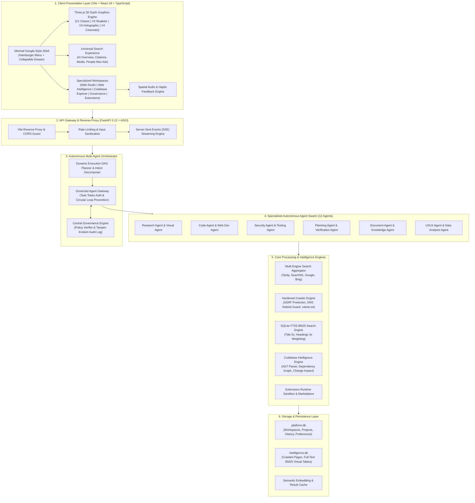

# Codebase Intelligence Engine (CIE)

A high-performance codebase analysis and architecture visualization studio built with **FastAPI** (Python 3.12) and **React 18 + TypeScript + Vite**.

---

# ANVESHA — Universal AI Search & Codebase Intelligence Platform

A state-of-the-art AI search engine, autonomous multi-agent governance platform, and codebase intelligence studio built with **FastAPI** (Python 3.12), **React 18 + TypeScript + Vite**, and **Three.js WebGL**.

---

## 🏛️ System Architecture Overview (Whole System)

ANVESHA is engineered with a **decoupled, event-driven, multi-tier architecture** designed for high concurrency, real-time telemetry streaming, zero-trust multi-agent governance, and immersive 3D spatial computing.



---

## 📂 Complete Codebase Structure Map

```
codebasec intelligemce engine/
├── backend/                                # High-performance FastAPI backend (Python 3.12)
│   ├── app/
│   │   ├── main.py                         # FastAPI ASGI entrypoint, middleware, and route mounting
│   │   ├── agents/                         # 12 Autonomous specialized agents & registry
│   │   │   ├── base.py                     # BaseAgent lifecycle, state machine, and tool execution
│   │   │   ├── registry.py                 # Dynamic agent discovery and dispatch registry
│   │   │   ├── research_agent.py           # Deep research & multi-source web synthesis
│   │   │   ├── visual_agent.py             # Image analysis and multimedia extraction
│   │   │   ├── code_agent.py               # Code generation, AST inspection, refactoring
│   │   │   ├── web_dev_agent.py            # Full-stack prototype and live studio agent
│   │   │   ├── security_agent.py           # Vulnerability scanning & security auditing
│   │   │   ├── testing_agent.py            # Automated test generation and coverage analysis
│   │   │   ├── planning_agent.py           # Multi-step DAG goal planning and task breakdown
│   │   │   ├── verification_agent.py       # Fact-checking, citation checking, hallucination detection
│   │   │   ├── document_agent.py           # PDF, DOCX, Markdown document parsing and chunking
│   │   │   ├── knowledge_agent.py          # Organizational memory and vector search
│   │   │   ├── ui_ux_agent.py              # Interface ergonomics, design token enforcement
│   │   │   └── data_analysis_agent.py      # Quantitative analytics and benchmark parsing
│   │   ├── orchestrator/                   # Autonomous multi-agent coordination
│   │   │   ├── orchestrator.py             # Central Orchestrator routing user tasks to agents
│   │   │   ├── planner.py                  # Dynamic DAG decomposition & dependency planner
│   │   │   ├── gateway.py                  # Governed Agent Gateway (token auth, circular loop guard)
│   │   │   ├── tool_registry.py            # Sandboxed tool registration and dispatcher
│   │   │   └── workflow_engine.py          # State machine driving multi-agent workflows
│   │   ├── governance/                     # Safety & compliance layer
│   │   │   └── engine.py                   # Central Governance Engine (risk scoring, policy rules, audit log)
│   │   ├── memory/                         # Persistent conversation and context service
│   │   │   └── service.py                  # SQLite memory store for session history & pins
│   │   ├── core/                           # Foundation runtime & AI integration
│   │   │   ├── config.py                   # Pydantic environment configuration & secrets
│   │   │   ├── db.py                       # SQLite async database connection pool
│   │   │   ├── ai_provider.py              # Google Gemini & external LLM client interfaces
│   │   │   ├── model_router.py             # Dynamic model routing based on query complexity
│   │   │   ├── adaptive_classifier.py      # Real-time intent & complexity classification
│   │   │   ├── self_optimizer.py           # Prompt and retrieval self-tuning loop
│   │   │   └── extensions_engine.py        # Dynamic plugin discovery, lifecycle, and execution
│   │   └── api/                            # RESTful & SSE API route controllers
│   │       ├── search.py                   # Legacy search endpoints
│   │       ├── search_v2.py                # Universal multi-engine search & codebase diagnostics
│   │       ├── crawler.py                  # Crawler status, manual triggers, and FTS5 search
│   │       ├── orchestrator.py             # Multi-agent task execution and status streaming
│   │       ├── governance.py               # Governance console policies, risk scores, and audit logs
│   │       ├── documents.py                # Document upload, ingestion, and parsing
│   │       ├── ai_providers.py             # AI provider configuration and health checks
│   │       ├── extensions.py               # Extension registry, install/uninstall, and settings
│   │       ├── platform.py                 # Workspaces, projects, history, and telemetry
│   │       └── health.py                   # Liveness and readiness health checks
│   ├── engine/                             # Core Search & Intelligence Processing Engines
│   │   ├── web_search.py                   # Multi-engine search aggregator (Tavily, Bing, Google)
│   │   ├── searxng_client.py               # Metasearch client integration
│   │   ├── query_understanding.py          # Query expansion, intent detection, and spell correction
│   │   ├── citation_verifier.py            # Real-time citation verification and URL validation
│   │   ├── codebase_intelligence.py        # AST parsing, symbol indexing, dependency graphs, impact analysis
│   │   ├── cache_engine.py                 # Multi-tier TTL query and embedding cache
│   │   ├── crawler/                        # Hardened web crawler
│   │   │   ├── engine.py                   # Main crawling worker and queue scheduler
│   │   │   ├── security.py                 # SSRF protection, private IP filtering, DNS rebind guard
│   │   │   ├── robots.py                   # robots.txt parser and politeness rate limiter
│   │   │   ├── indexer.py                  # SQLite FTS5 BM25 full-text indexing engine
│   │   │   ├── extractor.py                # HTML readability extraction and metadata parsing
│   │   │   └── dedup.py                    # Content hash and SimHash deduplication
│   │   └── semantic/                       # Hybrid retrieval and embeddings
│   │       ├── embeddings.py               # Vector embedding generation
│   │       ├── hybrid_retriever.py         # BM25 + Vector hybrid rank fusion (RRF)
│   │       └── reranker.py                 # Cross-encoder semantic reranker
│   └── requirements.txt                    # Python dependencies
│
├── frontend/                               # Modern React 18 + TypeScript + Vite UI
│   ├── src/
│   │   ├── main.tsx                        # React application bootstrap
│   │   ├── App.tsx                         # Root shell, routing, theme provider, and global modals
│   │   ├── index.css                       # Global styles, Tailwind directives, and CSS reset
│   │   ├── components/                     # Reusable modular UI components
│   │   │   ├── AppHeader.tsx               # Minimal Google-style header with hamburger trigger
│   │   │   ├── AppSidebar.tsx              # Collapsible navigation drawer overlay (all 9 views)
│   │   │   ├── SearchHomepage.tsx          # Clean homepage with centered 3D Earth and search input
│   │   │   ├── SearchBar.tsx               # Omnibox search input with suggestion dropdown
│   │   │   ├── EarthGlobe.tsx              # 3D Earth Globe Engine (V1 Classic & V2 Realistic)
│   │   │   ├── EarthGlobeV3.tsx            # 3D Earth Globe Engine (V3 Holographic Point-Cloud)
│   │   │   ├── EarthGlobeV4.tsx            # 3D Earth Globe Engine (V4 Cinematic Deep Space)
│   │   │   ├── SettingsModal.tsx           # Settings, appearance, and 3D globe customizer
│   │   │   ├── CodebaseExplorerView.tsx    # Interactive codebase file tree and code viewer
│   │   │   ├── CodebaseToolsPanel.tsx      # Dependency graph, change-impact, and security insights
│   │   │   ├── WebIntelligenceView.tsx     # Crawler telemetry, SSRF status, and FTS5 search
│   │   │   ├── WebDevStudioView.tsx        # Live HTML/CSS/JS web playground and preview
│   │   │   ├── MultiAgentWorkspace.tsx     # Multi-agent task execution and live event timeline
│   │   │   ├── GovernanceConsole.tsx       # Safety policies, risk audit log, and approval queue
│   │   │   ├── DeepResearchWorkspace.tsx   # Multi-step deep research and synthesis workspace
│   │   │   ├── HistoryView.tsx             # Full search and conversation history management
│   │   │   ├── ExtensionSidePanel.tsx      # Installed extensions drawer and marketplace
│   │   │   ├── CommandPalette.tsx          # Quick launcher palette (Ctrl+K)
│   │   │   └── search/                     # Google-grade search result components
│   │   │       ├── AIOverview.tsx          # Streaming AI overview with markdown and inline citations
│   │   │       ├── KnowledgePanel.tsx      # Entity knowledge card with key facts
│   │   │       ├── OrganicResultsList.tsx  # Organic web result items with favicons and snippets
│   │   │       ├── PeopleAlsoAsk.tsx       # Expandable interactive Q&A accordion
│   │   │       ├── SourcePreviewCard.tsx   # Visual card preview with thumbnail
│   │   │       └── FollowUpInput.tsx       # Contextual multi-turn follow-up input
│   │   ├── services/                       # Frontend API client and state services
│   │   │   ├── api.ts                      # Typed REST API service for search, crawler, codebase, etc.
│   │   │   ├── globeSettings.ts            # Persistent 3D globe appearance and shader settings
│   │   │   ├── audioService.ts             # Web Audio API spatial sound generator
│   │   │   └── extensionRegistry.ts        # Dynamic plugin discovery and IPC messaging
│   │   ├── styles/
│   │   │   └── design-tokens.css           # CSS variables for themes (Obsidian Cyber & Solar Glass)
│   │   └── types/                          # TypeScript interfaces and schema models
│   │       ├── api.ts                      # Core API response types, view enums, and models
│   │       └── extension.ts                # Extension manifest and lifecycle types
│   ├── vite.config.ts                      # Vite configuration with /api reverse proxy and chunk splitting
│   ├── tailwind.config.js                  # Tailwind design system configuration
│   └── package.json                        # Frontend NPM dependencies
│
├── extensions/                             # Extension & Plugin Ecosystem
│   ├── starter-template/                   # Template for creating custom ANVESHA extensions
│   │   ├── manifest.json                   # Extension manifest and permission scopes
│   │   └── src/index.ts                    # Extension lifecycle hooks and UI panel
│   └── sample-git-metrics/                 # Sample extension tracking Git commit activity
│
├── docs/                                   # Architectural specifications & validation reports
│   ├── ANVESHA_ARCHITECTURE_V2.md          # Multi-agent governance architecture specification
│   ├── ANVESHA_SEARCH_ARCHITECTURE.md      # Multi-engine search aggregator design
│   ├── GLOBE_IMPLEMENTATION_REPORT.md      # 3D Three.js Earth technical implementation
│   ├── CRAWLER_AND_INDEXING_REPORT.md      # Security-hardened web crawler design
│   ├── EXTENSION_SYSTEM.md                 # Plugin architecture specification
│   └── screenshots/                        # Visual regression baseline and release captures
│
└── scripts/                                # Verification and test automation scripts
    ├── verify-sidebar-drawer.mjs           # Minimal Google-style drawer automated verification
    ├── verify-globe-implementation.mjs     # 3D globe V1/V2 rendering and shader verification
    ├── verify-globe-v3.mjs                 # 3D globe V3 holographic point-cloud verification
    └── capture-sidebar-drawer.mjs          # Headless Puppeteer visual capture script
```

---

---

## Getting Started

### 1. Start the Backend Server (FastAPI)

```bash
# Navigate to the project root and activate virtual environment
cd "/home/amit/codebasec intelligemce engine"
backend/.venv/bin/uvicorn app.main:app --host 127.0.0.1 --port 8000 --reload
```
* **Interactive API Documentation**: Open [http://127.0.0.1:8000/docs](http://127.0.0.1:8000/docs) in your browser.
* **Health Endpoint**: [http://127.0.0.1:8000/api/health](http://127.0.0.1:8000/api/health)

---

### 2. Start the Frontend Development Server (Vite)

```bash
# In a separate terminal tab
cd "/home/amit/codebasec intelligemce engine/frontend"
npm run dev
```
* **Frontend Web Dashboard**: Open [http://127.0.0.1:5173](http://127.0.0.1:5173) in your browser.

---

## 🗺️ GitHub Milestone Roadmap

Track live progress, issues, and releases directly on [GitHub Milestones](https://github.com/anveshax/Da-vinci-code---search-engine/milestones).

| Milestone | Status | Description | Tracking |
| :--- | :---: | :--- | :---: |
| **Milestone 1: Core Architecture & Live Telemetry** | ✅ Complete | Application Shell, FastAPI backend, Vite React frontend, and Live Telemetry Connectivity. | [Milestone #1](https://github.com/anveshax/Da-vinci-code---search-engine/milestone/1) |
| **Milestone 2: Multi-Agent AI Search & Research Engine** | ✅ Complete | Universal multi-engine aggregation (Tavily, SearXNG, Bing, Google), query expansion, deep research multi-agent orchestration, SSE streaming synthesis, and visual media extraction. | [Milestone #2](https://github.com/anveshax/Da-vinci-code---search-engine/milestone/2) |
| **Milestone 3: 3D Earth Globe Visualizations & Graphics Engine** | ✅ Complete | Interactive WebGL Three.js Earth with 4 independent variants (V1 Classic, V2 Realistic Immersive, V3 Holographic Point-Cloud, V4 Cinematic Deep Space), orbit bloom nodes, real-time shader controls, and mobile responsive camera framing. | [Milestone #3](https://github.com/anveshax/Da-vinci-code---search-engine/milestone/3) |
| **Milestone 4: Minimal Google-Style UI & Collapsible Navigation Drawer** | ✅ Complete | Minimal full-width homepage layout, top-left hamburger menu trigger, collapsible overlay drawer with backdrop blur, keyboard navigation (Escape), and full access to all 9 navigation modules. | [Milestone #4](https://github.com/anveshax/Da-vinci-code---search-engine/milestone/4) |
| **Milestone 5: AST Ingestion, Codebase Intelligence & Dependency Graph** | 🔄 In Progress | Multi-language AST parsing, symbol hierarchy indexing, interactive node-edge dependency graph visualization, and Git diff change-impact inspector. | [Milestone #5](https://github.com/anveshax/Da-vinci-code---search-engine/milestone/5) |
| **Milestone 6: Voice Assistant & Multimodal Conversational Interface** | 📋 Planned | Voice query interaction, Gemini Live API audio streaming, text-to-speech feedback, and voice-assisted exploration. | [Milestone #6](https://github.com/anveshax/Da-vinci-code---search-engine/milestone/6) |
| **Milestone 7: Autonomous Agentic Workflows & Multi-Engine Extensions** | 📋 Planned | Plugin runtime ecosystem, external tool integrations, autonomous agent collaboration workflows, automated code verification, and security auditing. | [Milestone #7](https://github.com/anveshax/Da-vinci-code---search-engine/milestone/7) |
