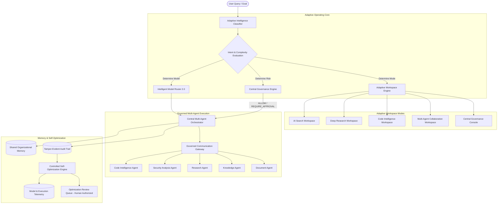

# ANVESHA — Adaptive AI Operating System
## System Architecture & Technical Specification

> **Tagline:** *"Intelligence That Adapts. Agents That Collaborate."*

---

## 1. Executive Summary & Vision

**ANVESHA** evolves from a hybrid multi-agent platform into a **Premium Adaptive AI Operating System**. 

Traditional AI developer platforms enforce rigid, static layouts: a user searching for documentation is given the same interface as an engineer conducting deep codebase security audits or a security auditor reviewing multi-agent collaboration DAGs.

ANVESHA's **Adaptive AI Operating System** bridges this divide by integrating:
1. **Adaptive Intelligence & Task Classifier**: Analyzes query intent, task complexity, context requirements, and risk level to dynamically reconfigure the operating workspace.
2. **Adaptive Workspace Engine**: Intelligently presents task-focused workspace views (Search, Deep Research, Code Intelligence, Multi-Agent Collaboration, AI Governance) without shifting controls unexpectedly or losing user state.
3. **Intelligent Model Router 2.0**: Selects models across Google Gemini, Groq, and OpenRouter based on capability vectors, live latency telemetry, cost, and context size.
4. **Governed Multi-Agent Mesh**: Real autonomous specialized agents executing real tools and model inferences, strictly bound by the Central Governance Engine.
5. **Self-Optimization & Telemetry Engine**: Analyzes task failure rates, identifies execution bottlenecks, monitors latency, and proposes auditable system optimizations with mandatory human approval guardrails.
6. **Dual-Theme Glassmorphism UI**: High-contrast Cyber Dark mode alongside a pristine Solar Glass light theme, engineered with fluid micro-interactions, responsive scrolling, zero layout clipping, and spatial audio feedback.

---

## 2. System Architecture

---

## 3. Core Engine Components

### 3.1 Adaptive Intelligence Classifier (`backend/app/core/adaptive_classifier.py`)
- **Task Complexity Spectrum**:
  - `simple`: Direct single-turn explanation or quick code snippet.
  - `moderate`: Targeted symbol lookup or live web search query.
  - `complex`: Multi-step codebase refactoring, impact analysis, or deep documentation synthesis.
  - `autonomous`: Full multi-agent orchestration requiring AST scanning, vulnerability auditing, live external research, and runbook alignment.
- **Dynamic Classification Heuristics**:
  - Evaluates vocabulary tokens, code snippets, intent markers, and file references.
  - Generates recommended workspace layout, required agents, tool capabilities, and risk score.

### 3.2 Adaptive Workspace Engine (Frontend)
- **Fluid Layout Switching**:
  - Automatically transitions between `search`, `deep_research`, `explorer`, `multi_agent`, and `governance`.
  - Non-destructive: preserves search query, input box focus, active file inspection, and ongoing background agent tasks.
  - Manual override pill allows users to lock into any preferred workspace mode or toggle `Auto-Adapt`.

### 3.3 Intelligent Model Router 2.0 (`backend/app/core/model_router.py`)
- **Multi-Factor Scoring Matrix**:
  $$\text{Score}(M) = w_{\text{cap}} \cdot C_M + w_{\text{lat}} \cdot (1 - L_M) + w_{\text{cost}} \cdot (1 - K_M) + w_{\text{ctx}} \cdot X_M$$
- Dynamically tests and routes to:
  - **Google Gemini** (`gemini-3.1-flash-lite`, `gemini-3-flash-preview`): Primary reasoning & code engine with 1M context window.
  - **Groq** (`llama-3.3-70b-versatile`): Ultra-low latency engine for fast streaming.
  - Transparent fallback: Retries automatically on 429 or 503 without leaking credentials across providers.

### 3.4 Self-Optimization & Telemetry Engine (`backend/app/core/self_optimizer.py`)
- **Bottleneck Detection**: Pinpoints execution steps with runtime $> 10\text{s}$ or memory spikes.
- **Repeated Error Analysis**: Detects recurrent issues (e.g., rate limits, missing AST imports, invalid regex).
- **Usability & Routing Telemetry**: Computes success rates and latency percentiles (P50, P95) for all configured models.
- **Guardrail Guarantee**: Proposes actionable prompt and workflow optimizations into an auditable queue. **Self-modifying code or automatic security permission changes are strictly disallowed without explicit human administrator approval.**

### 3.5 Premium Dual-Theme UI System
- **Obsidian Dark (Cyber)**: The signature ANVESHA aesthetic with dark glass, neon borders, and three-dimensional Earth visualization.
- **Solar Glass (Light)**: A refined, clean daytime theme with translucent white backdrop blur, crisp slate typography, and high contrast.
- **Reliability Fixes**:
  - Clamped headers with CSS padding prevention.
  - Scrollable containers with custom thin scrollbars preventing window scroll trapping.
  - Modals with `max-h-[85vh]` and internal scrolling.
  - Dropdowns rendered with `z-50` preventing container clipping.
